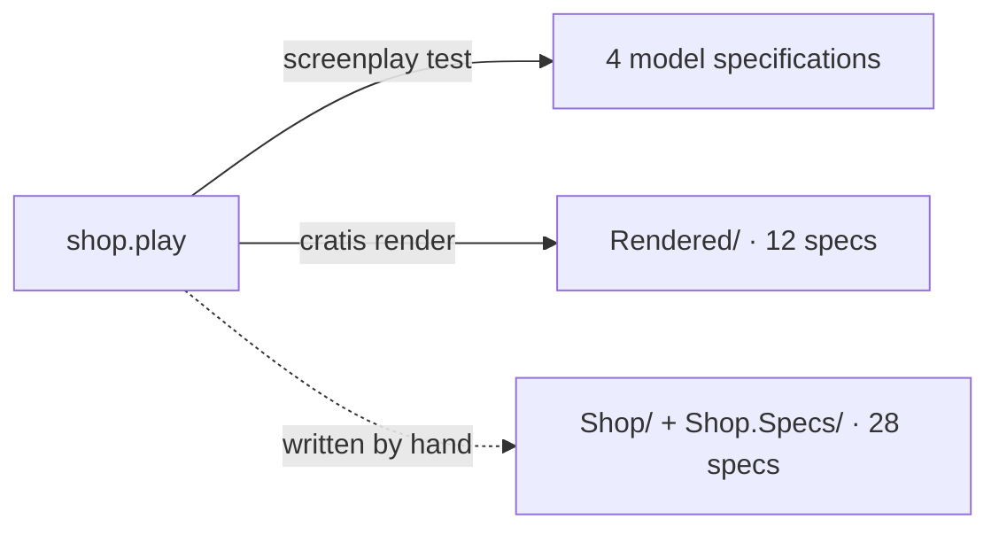

<div align="center">

# Generated Values Shop

### Declare a server-owned value once. Render it, write it by hand, and pin it in specs.

**Screenplay · Stage · Arc · Fundamentals**

[Back to all samples](../../README.md)

</div>

---

## The idea

A command that creates something needs an identity before it can record its first fact. If the caller supplies that identity, it becomes request input. In this shop the server owns four values instead:

| Concept | Strategy | Random bits | Role |
| --- | --- | ---: | --- |
| `CustomerId` | `cus_` + lowercase ULID | 80 | generated identifier |
| `OrderId` | TypeID `order_…` (UUIDv7 inside) | 74 | generated identifier, time from the command |
| `InviteCode` | NanoID, 10 characters without look-alikes | 50 | generated property, too short for an identifier |
| `ApiKey` | 32 random bytes, URL-safe base64 | 256 | generated property, kept off the causation chain |

The same shop appears three times, and every step is checked:



This sample is the source of the snippets in the [Generated values, from Screenplay to running app](https://www.cratis.io/tutorials/generated-values/) tutorial. For the API itself, see [Generating values](https://www.cratis.io/fundamentals/csharp/generating-values/) in Fundamentals.

## What is in the sample

```text
GeneratedValues/Shop/
├── dotnet-tools.json   pinned Screenplay compiler 4.151.0 and Cratis CLI 3.59.0
├── shop.play           the model: concepts with `generate`, commands, events, specifications
├── Rendered/           Stage's output for shop.play, committed as rendered
├── Shop/               the same shop written by hand with Arc
└── Shop.Specs/         in-process Arc command scenarios for Shop/
```

No step needs Docker, Chronicle or MongoDB. The model specifications run in Screenplay's in-memory evaluator, and both C# spec projects use Arc's in-process command scenarios. Only running `Shop/` or `Rendered/` as a web application needs Chronicle and MongoDB.

## Run it

Run these commands from this directory. They use the tool versions pinned in `dotnet-tools.json`; the Cratis CLI 3.53.1 from Homebrew bundles an older Screenplay that does not know `generate` yet.

```bash
dotnet tool restore
```

### 1. Compile the model and run its specifications

```bash
dotnet screenplay shop.play --warnaserror
```

```text
1 file(s) compiled - 0 error(s), 0 warning(s)
```

```bash
dotnet screenplay test shop.play
```

```text
shop.play(6,1): Information PLAY0270: A domain declaration is authoring metadata and is not part of ESM v1 behavior.
shop.play(50,9): Warning PLAY0683: Generated property 'inviteCode' of 'IssueInvite' has 50 random bits; 1% collision probability after about 4.757E+06 values.
passed: Shop.Customers.IssueApiKey.IssuingAnApiKey
passed: Shop.Customers.IssueInvite.IssuingAnInvite
passed: Shop.Customers.RegisterCustomer.RegisteringACustomer
passed: Shop.Orders.PlaceOrder.PlacingAnOrder
passed: 4 discovered, 4 selected, 4 executed; 4 passed, 0 failed, 0 unsupported
```

`PLAY0683` is the model telling the truth about `InviteCode`: 50 bits collide after a few million codes. Screenplay's fix is a unique constraint on the event property, but Stage refuses unique constraints on generated values, so this sample keeps the warning in view instead. Compilation alone does not report it; binding and the evaluator do.

### 2. Render the application

`Rendered/` was produced by this command, into a directory that did not exist yet:

```bash
dotnet cratis render shop.play --target cratis --name Shop --project-name Shop.Rendered --destination ./Rendered
```

```text
╭─Rendered─────────────────────────────────────────────────────────────────────╮
│ …/GeneratedValues/Shop/Rendered                                              │
│ Target:    cratis                                                            │
│ Documents: 1                                                                 │
│ Artifacts: 57                                                                │
│ Written:   57                                                                │
│ Removed:   0                                                                 │
│ Unchanged: 0                                                                 │
│ Recovered: False                                                             │
╰──────────────────────────────────────────────────────────────────────────────╯
```

Check that the committed output still matches the model; the command exits 0 when it is current and 6 when the model has changes that are not rendered yet:

```bash
dotnet cratis render shop.play --target cratis --name Shop --project-name Shop.Rendered --destination ./Rendered --check
```

Then build and run the rendered specifications. Stage turns each model specification into an Arc command scenario that pins the generated value by name:

```bash
dotnet test Rendered/Shop.Rendered.csproj --configuration Debug
```

```text
Passed!  - Failed:     0, Passed:    12, Skipped:     0, Total:    12
```

Do not edit files under `Rendered/`; change `shop.play` and render again. The rendered project pins Arc 22.83.0 and Chronicle 19.54.0, the versions Stage 4.92.0 targets. Building it in Debug also regenerates the TypeScript command proxies beside each command.

### 3. Build and specify the hand-written shop

```bash
dotnet test Shop.Specs/Shop.Specs.csproj --configuration Debug
```

```text
Passed!  - Failed:     0, Passed:    28, Skipped:     0, Total:    28
```

The build reports one warning, on purpose:

```text
Shop/Carts/Starting/StartCartWithInlineGeneration.cs(22,31): warning ARC0028: Move inline generation of 'CartId' to a [GeneratedValue] Handle parameter so scenarios can pin it
```

## A short tour

**Concepts own the strategy.** [`Common/CustomerId.cs`](./Shop/Common/CustomerId.cs) implements `IGeneratable<CustomerId>` with `$"cus_{GenerateValue.Ulid().ToLowerInvariant()}"`, which is what Stage renders for `generate ulid prefix "cus_" case lower`.

**Commands never receive their new identity.** [`RegisterCustomer`](./Shop/Customers/Registration/RegisterCustomer.cs) has only a name. Arc creates the `CustomerId` before calling `Handle([GeneratedValue("customerId")] CustomerId customerId)`, so the identifier is not part of the request. The rendered proxy, [`Rendered/Shop/Customers/RegisterCustomer/RegisterCustomer.ts`](./Rendered/Shop/Customers/RegisterCustomer/RegisterCustomer.ts), has a `name` property and nothing else.

**Time comes from the command.** [`OrderId`](./Shop/Orders/Placing/PlaceOrder.cs) implements `IGeneratableInContext<OrderId>` and calls `GenerateValue.TypeId("order", context)`. Arc passes the command's received time as `context.Now`. [`with_a_fixed_clock_and_tenant`](./Shop.Specs/Orders/Placing/for_PlaceOrder/when_placing_an_order/with_a_fixed_clock_and_tenant.cs) fixes the scenario clock and tenant and asserts that the time part of the generated `OrderId` equals the fixed clock. TypeID has no tenant part, so the fixed tenant only scopes the execution.

**Secrets stay off the causation chain.** [`ApiKey`](./Shop/Customers/ApiKeys/ApiKey.cs) is marked `[NotAudited]`, so any command that carries an `ApiKey` leaves its value out of the causation recorded with its events. [`when_revoking_an_api_key`](./Shop.Specs/Customers/ApiKeys/for_RevokeApiKey/when_revoking_an_api_key.cs) checks that. `[NotAudited]` does not cover event payloads, command responses or logs: `ApiKeyIssued` carries no key, and `IssueApiKey` returns the key once in its response.

**Specs pin values by name.** Every scenario pins its generated value with `PinGeneratedValue("<name>", …)`, using the same literal as the model's `for "…"` or `generated <name> = "…"`. [`without_a_pin`](./Shop.Specs/Orders/Placing/for_PlaceOrder/when_placing_an_order/without_a_pin.cs) shows the strict default: an unpinned generated value fails the command and tells you how to pin it.

**Migration from inline generation.** [`StartCartWithInlineGeneration`](./Shop/Carts/Starting/StartCartWithInlineGeneration.cs) calls `CartId.New()` inside `Handle()`, which triggers ARC0028. [`StartCart`](./Shop/Carts/Starting/StartCart.cs) is the result of the quick fix: a `[GeneratedValue("cart")]` parameter that [`when_starting_a_cart`](./Shop.Specs/Carts/Starting/for_StartCart/when_starting_a_cart.cs) pins.

## Known limits

- **Stage renders time-ordered values with the wall clock.** The rendered `OrderId` and `CustomerId` implement `IGeneratable<T>.New()`, not the context form, so their time part is not the command's received time. Only the hand-written `OrderId` uses `IGeneratableInContext<T>`.
- **No uniqueness check for generated values in the rendered app.** Stage refuses generated values mapped into unique-property constraints, so `InviteCode` keeps its `PLAY0683` collision warning.
- **Secrets cannot be generated by Screenplay yet.** `ApiKey` is modeled as `generate bytes 32 base64url`; the `[NotAudited]` marking exists only in the hand-written code.
- **Freshness is not guarded in the hand-written shop.** Stage renders a `BeforeFirst` concurrency scope for each generated event source; the hand-written handlers return plain `EventForEventSourceId` results until Arc ships its own freshness contract.
- **Studio editing of generation strategies** is not part of this sample yet.
- **`RevokeApiKey` is hand-written only.** It is not in `shop.play`; it exists to show what `[NotAudited]` covers.
