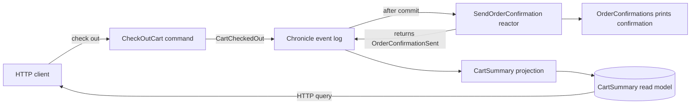

<div align="center">

# Step 04 — Reactors

### Send a confirmation after checkout and record the consequence

**Arc · Chronicle · ASP.NET Core**

Previous: [Step 03 — Commands and queries](../03-CommandsAndQueries/README.md) · [Learning path](../README.md)

</div>

---

## The idea

Checking out a cart should lead to an order confirmation. The checkout command records `CartCheckedOut`; a **reactor** responds to that recorded fact and sends the confirmation. This step prints it in the API terminal instead of sending real email, then returns `OrderConfirmationSent` so the cart's history records the consequence too.



Keep the decision about whether checkout can happen in the command. Use a reactor for work that follows a committed fact: sending a notification, calling another system, or recording a follow-up fact. Sending a confirmation inside the command could notify someone before checkout is successfully recorded, and makes checkout depend on the sender being available.

Reactors run after the event is committed and process it in the background. A successful checkout response means the fact is stored; it does not mean the confirmation has been sent. The reaction and the read model are **eventually consistent**.

Read [Event-driven architecture](https://www.cratis.io/concepts/event-driven-architecture/) for the concepts and [Chronicle reactors](https://www.cratis.io/chronicle/reactors/) for the API.

## Run it

Start Chronicle as described in the [learning path README](../README.md#before-you-start), then start the API from the repository root:

```bash
dotnet run --project LearningPath/04-Reactors/Reactors.csproj
```

The API listens on <http://localhost:5104> and uses the `LearningPathReactors` event store. Leave the API running so its reactor can receive events.

### Add an item and check out

In another terminal, choose a fresh cart id and send the commands:

```bash
CART_ID=$(uuidgen)

curl --request POST \
  --header 'Content-Type: application/json' \
  --data "{\"cartId\":\"${CART_ID}\",\"product\":\"Coffee beans\",\"quantity\":2}" \
  http://localhost:5104/api/carts/add-item-to-cart

curl --request POST \
  --header 'Content-Type: application/json' \
  --data "{\"cartId\":\"${CART_ID}\"}" \
  http://localhost:5104/api/carts/check-out-cart
```

As in step 03, `"isSuccess":true` in each command result means the event was appended. After checkout, the API terminal prints a line like this, with your cart id:

```text
Order confirmation sent for cart 7d9d3f76-0c2d-4a93-a67b-d8f8fb2bc941 (sample only; no email sent).
```

### See the consequence

Query the cart:

```bash
curl "http://localhost:5104/api/carts/by-id?id=${CART_ID}"
```

Once the reactor and projection have caught up, the `data` part of the query result looks like this:

```json
{"id":"7d9d3f76-0c2d-4a93-a67b-d8f8fb2bc941","itemCount":2,"checkedOut":true,"confirmationSent":true}
```

An immediate query can still show `confirmationSent` as `false`. Ask again after the confirmation appears. Open Workbench at <https://localhost:35000>, select `LearningPathReactors`, and inspect the event sequence for this cart. You will find `ItemAddedToCart`, `CartCheckedOut`, and `OrderConfirmationSent` in that order.

Use a fresh cart id when you repeat the exercise. Each checkout event triggers a confirmation, even if you check out the same cart twice. Stop the API with Ctrl+C when you are done; remove the Chronicle development container as described in the [learning path README](../README.md#before-you-start).

## Code tour

| File | What it shows |
| --- | --- |
| [`SendOrderConfirmation.cs`](./SendOrderConfirmation.cs) | An `IReactor` with a checkout handler that calls a collaborator and returns a follow-up event |
| [`IOrderConfirmations.cs`](./IOrderConfirmations.cs), [`OrderConfirmations.cs`](./OrderConfirmations.cs) | An injected sender that prints the sample confirmation |
| [`Events.cs`](./Events.cs) | The cart events, now including `OrderConfirmationSent` |
| [`CartSummary.cs`](./CartSummary.cs) | The step 03 read model and query, with `ConfirmationSent` set by the follow-up event |
| [`CheckOutCart.cs`](./CheckOutCart.cs) | The unchanged command: it only returns `CartCheckedOut` |
| [`Program.cs`](./Program.cs), [`appsettings.json`](./appsettings.json) | The same host setup, with this step's own event store |
| [`AddItemToCart.cs`](./AddItemToCart.cs), [`RemoveItemFromCart.cs`](./RemoveItemFromCart.cs), [`CartId.cs`](./CartId.cs), [`ProductName.cs`](./ProductName.cs), [`Quantity.cs`](./Quantity.cs) | The same commands and domain types as step 03 |

The reactor handler, with its documentation comments omitted:

```csharp
public class SendOrderConfirmation(IOrderConfirmations orderConfirmations) : IReactor
{
    [OnceOnly]
    public OrderConfirmationSent CheckedOut(CartCheckedOut @event, EventContext context)
    {
        orderConfirmations.Send(new CartId(Guid.Parse(context.EventSourceId.Value)));

        return new();
    }
}
```

Chronicle discovers the reactor through `IReactor`. The first parameter of its public method selects the event it handles; the method name is yours to choose. `EventContext` supplies the cart's event source id, and constructor injection supplies `IOrderConfirmations`. Arc binds `IOrderConfirmations` to `OrderConfirmations` by convention, so there is no registration to add.

Only after the sender completes does the handler return `OrderConfirmationSent`. Chronicle appends that returned event to the triggering cart's event source. The event is a new fact other observers can use, and the projection sets `ConfirmationSent` to `true`. The reactor never updates the read model or calls the event log directly. If the sender throws or the returned event cannot be appended, the reactor's partition fails; checkout remains recorded.

### Replay and retries

`[OnceOnly]` keeps this handler out of deliberate **replay**, so replaying it does not resend confirmations or append the follow-up again. It is not an exactly-once guarantee. Delivery is **at least once**: recovering a failed partition can invoke the handler again, including after the sender completed but before the follow-up was recorded.

Printing twice is harmless here. A real sender needs an **idempotency key** that it stores durably and recognizes on retry, so repeated delivery does not send a second email or charge a customer twice. Chronicle's [delivery identity](https://www.cratis.io/chronicle/reactors/delivery-identity/) provides a stable key for that purpose. The external side effect and the follow-up append are not one atomic transaction.

## Make it yours

- Change the text in `OrderConfirmations.Send` and repeat the checkout with a fresh cart id.
- Add a reactor for `ItemAddedToCart` that prints which product was added, without returning another event.
- Add a `ReceiptPrepared` follow-up event and a reactor that handles `OrderConfirmationSent`, then find the chain of facts in Workbench.

## Next

[Step 05 — Testing](../05-Testing/README.md) proves the cart's commands, projection, and reactor with specs that run without Chronicle. The [Chronicle Processing](../../Chronicle/Processing/README.md) sample compares reactors, projections, and reducers on one stream.

## Questions? Ask on Discord

Ask questions and get help from the Cratis team and other developers on the [Cratis Discord](https://discord.gg/kt4AMpV8WV).
