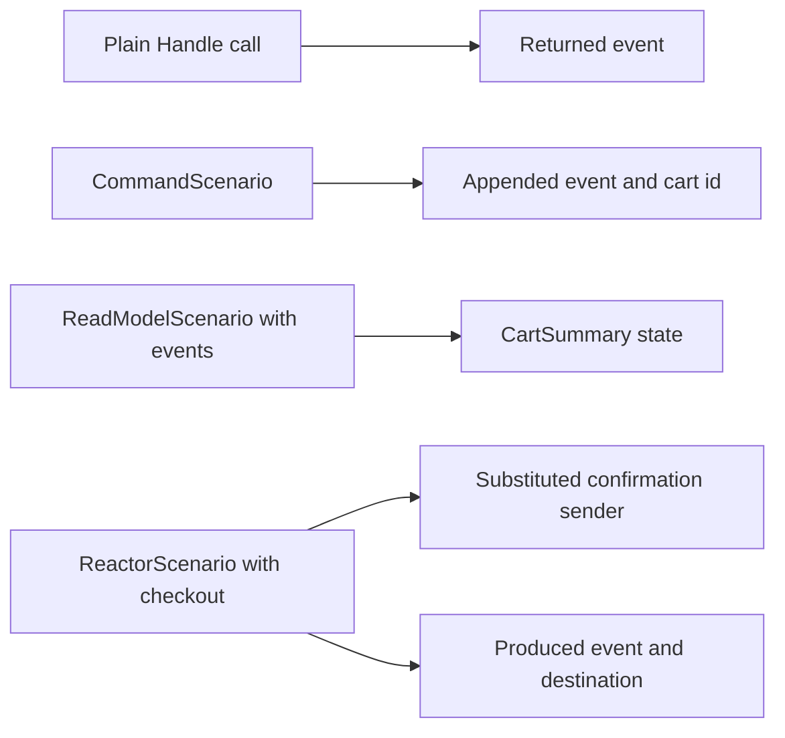

<div align="center">

# Step 05 — Testing

### Prove the cart's behavior without starting Chronicle

**Arc · Chronicle · Cratis Specifications · xUnit · NSubstitute**

Previous: [Step 04 — Reactors](../04-Reactors/README.md) · [Learning path](../README.md)

</div>

---

## The idea

You can add items, remove them, check out, and send a confirmation. Now make those promises executable. This step copies step 04's cart unchanged into its own namespace and adds a dedicated `Testing.Specs` project. The specs exercise the decisions, command pipeline, projection, and reactor **in-process**: no Docker, HTTP API, database, or Chronicle server.



Use a plain call for a pure decision. Add a scenario when you need proof that the framework connects the pieces: Arc appends the returned event, projection attributes build the model, or Chronicle invokes the reactor with its dependencies. These are different promises, so a green decision spec does not replace a pipeline spec.

## Run it

You need only the [.NET 10 SDK](https://dotnet.microsoft.com/download). From the repository root:

```bash
dotnet test LearningPath/05-Testing/Testing.Specs/Testing.Specs.csproj --configuration Debug
```

The runner builds the cart and specs, then reports passed facts with no failures or skips. It does not start the sample API or contact the server configured in `appsettings.json`. Each scenario gets its own state and each spec uses a fresh cart id.

The package versions, including Arc's and Chronicle's testing packages and Cratis Specifications, are pinned in [`Directory.Packages.props`](../../Directory.Packages.props).

## Code tour

| Spec | What it proves |
| --- | --- |
| [`for_AddItemToCart/when_deciding_to_add_an_item.cs`](./Testing.Specs/for_AddItemToCart/when_deciding_to_add_an_item.cs) | Calling `Handle()` returns the requested product and quantity |
| [`for_AddItemToCart/when_adding_an_item.cs`](./Testing.Specs/for_AddItemToCart/when_adding_an_item.cs) | Arc succeeds and appends `ItemAddedToCart` with that payload on the requested cart's event source |
| [`for_RemoveItemFromCart/when_removing_an_item.cs`](./Testing.Specs/for_RemoveItemFromCart/when_removing_an_item.cs) | Arc appends `ItemRemovedFromCart` with the removed product and quantity |
| [`for_CheckOutCart/when_checking_out.cs`](./Testing.Specs/for_CheckOutCart/when_checking_out.cs) | Arc appends `CartCheckedOut` to the cart |
| [`for_CartSummary`](./Testing.Specs/for_CartSummary/) | Added quantities accumulate, removal subtracts, checkout sets `CheckedOut`, and confirmation sets `ConfirmationSent` |
| [`for_SendOrderConfirmation/when_the_cart_is_checked_out.cs`](./Testing.Specs/for_SendOrderConfirmation/when_the_cart_is_checked_out.cs) | Checkout sends one confirmation and produces `OrderConfirmationSent` for the same cart |

The application files are the same cart you just learned: [`Events.cs`](./Events.cs), [`CartSummary.cs`](./CartSummary.cs), and [`SendOrderConfirmation.cs`](./SendOrderConfirmation.cs). The specs sit in a separate project so they never become part of the running application.

### Read a spec as a sentence

`for_AddItemToCart / when_adding_an_item / should_append_the_item_to_the_cart` describes one behavior. Cratis Specifications runs the lifecycle by convention:

- **`Establish()`** sets up the world: a scenario or a substituted collaborator.
- **`Because()`** performs the action being specified.
- **`[Fact] should_*()`** asserts one outcome.
- **`Destroy()`** disposes the scenario.

Shared setup lives in `given/` contexts. The base context's `Establish()` runs before the derived spec's setup; do not call it yourself. Keep `Because()` in the concrete spec, not in the shared context. A dedicated spec project needs no `#if DEBUG` wrapper.

### Start with the decision

The [plain decision spec](./Testing.Specs/for_AddItemToCart/when_deciding_to_add_an_item.cs) calls `new AddItemToCart(...).Handle()` and asserts on the returned `ItemAddedToCart`. Nothing is appended. A direct call is useful when you want to specify a decision without bringing in the pipeline; it does not run validation, authorization, `Provide()`, or command operations.

### Add the command pipeline

The [add-item scenario spec](./Testing.Specs/for_AddItemToCart/when_adding_an_item.cs) inherits its setup from [`given/an_add_item_scenario.cs`](./Testing.Specs/for_AddItemToCart/given/an_add_item_scenario.cs). This excerpt is its action and assertions:

```csharp
async Task Because() => _result = await _scenario.Execute(new AddItemToCart(_cartId, "Coffee beans", 2));

[Fact] void should_succeed() => _result.ShouldBeSuccessful();
[Fact] async Task should_append_the_item_to_the_cart() => await _scenario.ShouldHaveAppendedEvent<AddItemToCart, ItemAddedToCart>(_cartId, @event => @event.Product.Value == "Coffee beans" && @event.Quantity.Value == 2);
```

`CommandScenario<AddItemToCart>` runs Arc's command pipeline. The success assertion and appended-event assertion answer different questions: did the command succeed, and did the expected fact reach the correct event source? The assertion extension comes from `Cratis.Arc.Chronicle.Testing.Commands`, takes both command and event type parameters, and accepts a **predicate** for the payload.

### Project events, not a prepared model

[`when_items_are_added.cs`](./Testing.Specs/for_CartSummary/when_items_are_added.cs) gives two add events with quantities 2 and 3 to `ReadModelScenario<CartSummary>`, then asserts an item count of 5. It also checks the cart id and initial flags. The other specs supply removal, checkout, and confirmation events, checking both their changes and the state that should stay intact.

Here `Given.ForEventSource(_cartId).Events(...)` is the action: the scenario collects the events and materializes the model when `Instance` is read. It discovers the model-bound attributes on `CartSummary`. Do not fill in a `CartSummary` yourself to specify the projection—that would bypass the transformation you want to prove. Assert on `_scenario.Instance` with the ordinary `ShouldEqual` or boolean assertions.

### Substitute the external effect

[`a_confirmation_scenario.cs`](./Testing.Specs/for_SendOrderConfirmation/given/a_confirmation_scenario.cs) creates an NSubstitute `IOrderConfirmations` and registers it in the reactor scenario's `Services`. Giving `CartCheckedOut` to `ReactorScenario<SendOrderConfirmation>` invokes the real handler, but the sender is a substitute: no email or console confirmation is sent.

The [reactor spec](./Testing.Specs/for_SendOrderConfirmation/when_the_cart_is_checked_out.cs) checks both the sender call and `ShouldHaveProduced<OrderConfirmationSent>(_cartId)`. The scenario records the returned event and its destination; this assertion does **not** prove a real kernel persisted it. Separately, the read-model specs prove what `OrderConfirmationSent` does to `CartSummary`.

Read [Chronicle testing](https://www.cratis.io/chronicle/testing/) for the scenario APIs.

## Pitfalls worth knowing

- **Await every assertion that returns `Task`.** A discarded asynchronous assertion can let a spec pass without observing its failure. Use `async Task` facts and `await`, as the command specs do. Chronicle's `CHR0039` analyzer reports non-awaited testing assertions. `ShouldHaveProduced` and this sample's `IOrderConfirmations.Send` are synchronous, so their facts are `void`.
- **Success alone is not the promised event.** Keep the event type, payload, and event-source assertion alongside `ShouldBeSuccessful()`.
- **No sleeps are needed.** Await scenario execution or event handling, then assert. These specs do not guess how long a server needs to catch up.
- **Scenarios do not replace infrastructure checks.** They do not prove HTTP routes, real transport, MongoDB persistence, background delivery/recovery, or `[OnceOnly]` replay behavior. Reserve real-server integration specs for those boundaries. The cart still has step 04's at-least-once delivery caveat.
- **The cart deliberately has no validation yet.** A remove or checkout command can execute without prior items. These specs record the current behavior; they do not add a rule that the application does not enforce.

## Run the cart too (optional)

The API is still runnable. Start Chronicle using the [learning path setup](../README.md#before-you-start), then run:

```bash
dotnet run --project LearningPath/05-Testing/Testing.csproj
```

This copy listens on <http://localhost:5105> and uses the `LearningPathTesting` event store. Follow [step 04's add-and-checkout exercise](../04-Reactors/README.md#add-an-item-and-check-out), replacing port `5104` with `5105` and selecting `LearningPathTesting` in Workbench. Use a fresh cart id for each run. Stop the API with Ctrl+C and remove the development container using the learning path instructions. The app uses development credentials and prints confirmations instead of sending email; do not deploy it as-is.

## Make it yours

- Remove the `AddFrom<ItemAddedToCart>` attribute from this step's `CartSummary`, run the specs, and see the count assertions fail. Restore it and rerun.
- Remove the sender call from this step's `SendOrderConfirmation`. The reactor's `Received(1)` assertion should fail even though a follow-up event is still returned. Restore the call.
- Add a spec for removing all items: give an add and a matching removal, then assert that `ItemCount` is zero.

## Next

Continue to [Step 06 — Event versioning](../06-EventVersioning/README.md) to record unit prices while keeping the cart's old history readable. The [Projection Styles sample](../../Chronicle/ProjectionStyles/README.md) offers more projection and reducer scenarios to explore.

## Questions? Ask on Discord

Ask questions and get help from the Cratis team and other developers on the [Cratis Discord](https://discord.gg/kt4AMpV8WV).
