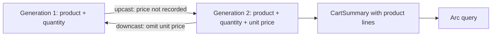

<div align="center">

# Step 06 — Event versioning

### Record unit prices without losing the cart's old history

**Arc · Chronicle · ASP.NET Core**

Previous: [Step 05 — Testing](../05-Testing/README.md) · [Learning path](../README.md)

</div>

---

## The idea

The shop now records the unit price when an item is added. Existing `ItemAddedToCart` events only recorded the product and quantity. You cannot recover a price that was never recorded, and changing the C# record alone does not explain how to read those old facts.

This step keeps the original shape as **generation 1**, declares the priced shape as **generation 2**, and supplies a migration between them. Both shapes describe the same fact and share one event type identity. The commands, checkout reactor, and confirmation behavior from step 05 remain; the cart query now includes product lines so you can see the migration's result.



You will declare an old generation, write an upcast and downcast, and query old and new history through the same read model. Read [What is event sourcing?](https://www.cratis.io/concepts/event-sourcing/) for why recorded facts remain history, and [Chronicle event type migrations](https://www.cratis.io/chronicle/concepts/event-type-migrations/) for the generation mechanism.

## Run it

Start Chronicle as described in the [learning path README](../README.md#before-you-start), then start the API from the repository root:

```bash
dotnet run --project LearningPath/06-EventVersioning/EventVersioning.csproj
```

The sample uses the repository's released Chronicle .NET client, **19.59.6**. The API listens on <http://localhost:5106> and uses the `LearningPathEventVersioning` event store. Leave it running while you send commands and query the projection.

At startup, `SeedCartHistory` appends one generation-1 `ItemAddedToCartV1` to cart `00000000-0000-0000-0000-000000000006`, but only if that cart has no events. It stands in for history from before the price existed; this sample does not rewrite an event or run an older application first. Run only one instance of the sample at a time: the existence check and append are not an atomic seed operation.

### Add an item with its price and check out

In another terminal, choose a fresh cart id and send the commands:

```bash
CART_ID=$(uuidgen)

curl --request POST \
  --header 'Content-Type: application/json' \
  --data "{\"cartId\":\"${CART_ID}\",\"product\":\"Coffee beans\",\"quantity\":2,\"unitPrice\":12.50}" \
  http://localhost:5106/api/carts/add-item-to-cart

curl --request POST \
  --header 'Content-Type: application/json' \
  --data "{\"cartId\":\"${CART_ID}\"}" \
  http://localhost:5106/api/carts/check-out-cart
```

`"isSuccess":true` in each command result means the event was appended. The API terminal prints the sample order confirmation after checkout, just as in step 05. The read model and reactor are eventually consistent.

### Query the new cart

```bash
curl "http://localhost:5106/api/carts/by-id?id=${CART_ID}"
```

Once the reactor and projection have caught up, the `data` part of the result looks like this, with your cart id:

```json
{"id":"7d9d3f76-0c2d-4a93-a67b-d8f8fb2bc941","itemCount":2,"checkedOut":true,"confirmationSent":true,"lines":[{"product":"Coffee beans","quantity":2,"unitPrice":12.5}]}
```

If you query immediately, ask again after the confirmation appears. The line's price came from the generation-2 event, not from today's product catalog.

### Query the old cart

```bash
OLD_CART_ID=00000000-0000-0000-0000-000000000006
curl "http://localhost:5106/api/carts/by-id?id=${OLD_CART_ID}"
```

After the projection catches up, its `data` is:

```json
{"id":"00000000-0000-0000-0000-000000000006","itemCount":2,"checkedOut":false,"confirmationSent":false,"lines":[{"product":"Coffee beans","quantity":2,"unitPrice":0}]}
```

Here **0 means not recorded**, not free. The migration supplies `Price.NotRecorded` because generation 1 has no price. Product and quantity still come from the original fact.

Stop the API with Ctrl+C, start it with the same `dotnet run` command, and query the old cart again. Its quantity remains 2: restarting did not append another seed event. Use a fresh cart id for each new-cart exercise. The fixed old cart is reserved for the seed demonstration; sending commands to it changes the result.

### What Chronicle stored

Open Workbench at <https://localhost:35000>, select `LearningPathEventVersioning`, and open the event log. Find each cart by its event source id and select its `ItemAddedToCart` event. Open the **Content** tab and switch the **Generation** selector between 1 and 2:

| Appended fact | Generation 1 | Generation 2 |
| --- | --- | --- |
| Seeded old cart | Product and quantity as written | Same product and quantity, with unit price 0 |
| New cart | Product and quantity; price omitted by downcast | Product, quantity, and unit price 12.50 as written |

Chronicle stores both generations for **each addition event**, not two events in the cart's history. The appended generation stays as written; the other representation contains what the migration produces. The new cart also has `CartCheckedOut` and `OrderConfirmationSent`, as before.

Stop the API when you are done. Removing the disposable Chronicle development container as described in the [learning path README](../README.md#before-you-start) resets this exercise's event and read-model data. These local development credentials and the unauthenticated sample API are not production configuration.

## Code tour

| File | What it shows |
| --- | --- |
| [`Events.cs`](./Events.cs), [`ItemAddedToCartV1.cs`](./ItemAddedToCartV1.cs) | Current and previous generations of the same addition event |
| [`ItemAddedToCartMigration.cs`](./ItemAddedToCartMigration.cs) | Upcast with an honest default; downcast to the original schema |
| [`Price.cs`](./Price.cs) | A strongly typed price with the `NotRecorded` sentinel |
| [`AddItemToCart.cs`](./AddItemToCart.cs) | The command now returns a generation-2 event with its unit price |
| [`CartSummary.cs`](./CartSummary.cs), [`CartLine.cs`](./CartLine.cs) | A model-bound children projection keyed by product, served by the existing query |
| [`SeedCartHistory.cs`](./SeedCartHistory.cs), [`Program.cs`](./Program.cs) | Startup history that is appended once on sequential starts |
| [`CheckOutCart.cs`](./CheckOutCart.cs), [`SendOrderConfirmation.cs`](./SendOrderConfirmation.cs), [`IOrderConfirmations.cs`](./IOrderConfirmations.cs), [`OrderConfirmations.cs`](./OrderConfirmations.cs) | The checkout command and reactor from step 05 |
| [`RemoveItemFromCart.cs`](./RemoveItemFromCart.cs), [`CartId.cs`](./CartId.cs), [`ProductName.cs`](./ProductName.cs), [`Quantity.cs`](./Quantity.cs) | The existing command and domain types |
| [`appsettings.json`](./appsettings.json) | This step's own event store |

`[EventType(generation: 2)]` keeps the `ItemAddedToCart` type-name identity used in the earlier steps; no explicit id is required here. `[EventTypeGenerationFor<ItemAddedToCart>(1)]` makes the old type resolve that same identity rather than acquiring the unrelated id `ItemAddedToCartV1`. Chronicle discovers the migration automatically.

`Upcast` declares `DefaultValue` for `UnitPrice`. `Downcast` needs no property operations: Chronicle walks generation 1's target schema, retaining product and quantity and omitting unit price. The [C# migration guide](https://www.cratis.io/chronicle/migrations/dotnet-client/) covers this and the other transformation operations.

`CartSummary.Lines` uses `[ChildrenFrom]` with the event's product as the child key. `CartLine.Product` is marked `[Key]`; its attributes add and subtract quantity and set the price from the latest addition. `[NoAutoMap]` keeps those explicit quantity operations from being replaced by a copied event quantity. This small example retains zero-quantity lines and uses the latest addition's price for each product; it does not calculate an invoice total or model separate price lots.

## Pitfalls to avoid

- **Do not invent missing data.** A default is a declared interpretation of absence. `Price.NotRecorded` cannot tell you what the customer paid. This sample reserves zero for that meaning; a real shop that supports free items needs a representation that distinguishes them.
- **Keep what consumers need.** Downcasting here deliberately loses the price because generation-1 consumers never had it. For renames, splits, or combinations, check that every needed part survives. Storing another generation does not make a lossy migration lossless.
- **Keep old generation types unchanged while their events exist.** Do not edit or delete `ItemAddedToCartV1` to make a new shape fit. Add the next generation and a migration for each consecutive pair.
- **Do not assume every observer receives your current CLR generation.** Reactors and reducers receive the appended generation live by default in this Chronicle major version. See [pinned observer delivery](https://www.cratis.io/chronicle/concepts/event-type-migrations/#opt-in-to-pinned-observer-delivery) before adding a handler that depends on a particular generation. This step keeps the checkout reactor, whose event shape did not change.

## Make it yours

- Add a second product with a different price to a fresh cart and inspect both lines.
- Add more of the same product, then remove one. Compare the line quantity with `ItemCount`.
- Inspect both stored generations of the seeded event and explain why the migration cannot recover its original price.

## Next

Continue to [Step 07 — Validation and authorization](../07-ValidationAndAuthorization/README.md) to reject invalid input, protect checkout decisions, and require a customer role. Step 07 uses the flat, unpriced cart from step 05: its protected decision read does not support this step's children projection. The [Chronicle Processing](../../Chronicle/Processing/README.md) sample compares reactors, projections, and reducers on one stream.

## Questions? Ask on Discord

Ask questions and get help from the Cratis team and other developers on the [Cratis Discord](https://discord.gg/kt4AMpV8WV).
