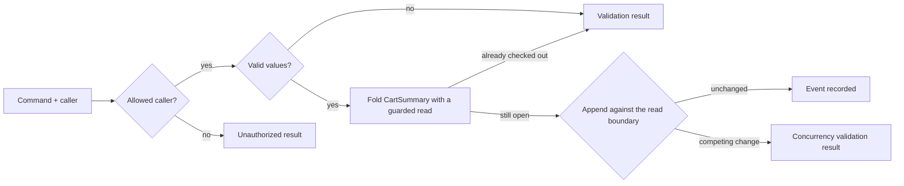

<div align="center">

# Step 07 — Validation and authorization

### Reject bad input, protect checkout decisions, and restrict who may act

**Arc · Chronicle · Concept validators · Protected decisions · Roles**

Previous: [Step 06 — Event versioning](../06-EventVersioning/README.md) · [Learning path](../README.md)

</div>

---

## The idea

Step 05 proves what the cart does, but it accepts zero quantities, empty product names, changes after checkout, and checkout from anyone. This copy adds rules and specs for those refusals. After [step 06's event versioning exercise](../06-EventVersioning/README.md), this step returns to step 05's flat, unpriced cart so the protected decision read has a supported projection shape.



Authorization runs **before validation**, then Arc resolves handler inputs and calls `Handle()`. A denied caller does not learn whether their input passes the validators. A direct `Handle()` call skips these pipeline checks.

## Prove the rules without a server

You need the [.NET 10 SDK](https://dotnet.microsoft.com/download). From the repository root:

```bash
dotnet test LearningPath/07-ValidationAndAuthorization/ValidationAndAuthorization.Specs/ValidationAndAuthorization.Specs.csproj --configuration Debug
```

The specs need no Docker, HTTP host, or Chronicle server. Versions come from [`Directory.Packages.props`](../../Directory.Packages.props): Arc `22.88.0`, Chronicle `19.59.2`, and Cratis Specifications `4.1.1`.

| Layer | Rule in this cart | Source |
| --- | --- | --- |
| Value invariant | Quantity is greater than zero; product name is not empty or whitespace | [`QuantityValidator.cs`](./QuantityValidator.cs), [`ProductNameValidator.cs`](./ProductNameValidator.cs) |
| Protected state decision | No add, removal, or second checkout after checkout | [`AddItemToCart.cs`](./AddItemToCart.cs), [`RemoveItemFromCart.cs`](./RemoveItemFromCart.cs), [`CheckOutCart.cs`](./CheckOutCart.cs) |
| Authorization | Add, remove, and query need authentication; checkout also needs the `Customer` role | The command attributes, [`CartRole.cs`](./CartRole.cs), and [`CartSummary.ById`](./CartSummary.cs) |

### Values carry their rules

`ConceptValidator<Quantity>` and `ConceptValidator<ProductName>` apply wherever Arc validates those concepts, including both add and remove commands. Arc discovers the validators; there is no per-command registration. Their public constructors are parameterless, as protected commands require.

Use `CommandValidator<TCommand>` when the input has a rule that belongs to that operation—for example, a relationship between two fields—not when you would repeat a value invariant. This cart has no such input rule, so it has no empty command validator. See [command validation](https://github.com/Cratis/Arc/blob/main/Documentation/backend/csharp/commands/validation.md).

### State must stay valid until the append

Each command declares `[ProtectedDecision]` and takes `DecisionRead<CartSummary>` in `Handle()`. Arc resolves it for the command's `CartId`, folds the relevant events, and enrolls the read in the command's Chronicle unit of work. The handler returns `Result<TEvent, ValidationResult>`: either the new fact or a normal business rejection, never an exception for checkout refusal.

If another writer changes that cart after the read, the append fails with a validation result whose reason is `concurrencyViolation`. Nothing from the rejected command commits, and Arc does not retry it automatically. Read fresh state before deciding whether to submit again.

A plain `CartSummary` parameter or `IReadModels.GetInstanceById` inside a handler is **advisory**, not a concurrency guard. Moving that read into a validator does not fix the race; `ARCCHR0011` points out unguarded decision reads. Keep the state rule in the protected handler. The flat, event-source-keyed `CartSummary` projection is admitted for decision reads; a reducer or a projection with joins/children is not interchangeable. Read [decision reads in commands](https://github.com/Cratis/Arc/blob/main/Documentation/backend/csharp/chronicle/read-models/injecting-into-commands.md#decision-reads-for-event-dependent-commands).

Absence still means an open cart, preserving the earlier steps' behavior. This lesson adds no stock, per-product balance, empty-cart, or ownership rule. In particular, authentication is not ownership: any authenticated caller can read or change any open cart, and any customer can check one out. A real shop needs a separate ownership policy.

### Specify rejection, not just failure

[`ValidationAndAuthorization.Specs`](./ValidationAndAuthorization.Specs/) copies step 05's projection/reactor coverage and extends the command scenarios:

- Direct concept-validator specs check positive, zero, negative, empty, and whitespace values; command specs prove those validators run in the pipeline.
- Authenticated add/remove and customer checkout succeed and append the intended event for the correct cart.
- Seeded checkout events reject all three commands. Each rejection asserts both `ShouldNotBeSuccessful()` and `ShouldHaveValidationErrors()`, plus no committed command events.
- Missing authentication or customer role asserts `ShouldNotBeAuthorized()`, not validation failure. The anonymous add spec submits invalid input too and checks that no validation errors are disclosed.
- Each command has a competing-checkout spec using `AppendConcurrently`, asserting `ConcurrencyViolation` and no committed command events.

The shared [`a_cart_command_scenario`](./ValidationAndAuthorization.Specs/given/a_cart_command_scenario.cs) calls `UseDecisionReads()` **before seeding**. Seed actual events through `Given.ForEventSource(id).Events(...)`; a pinned read model cannot provide a guard. The principal accessor is substituted in specs, not in the application. The direct decision spec uses an explicitly unprotected snapshot only to call the pure handler; it proves no concurrency or authorization guarantee.

`/validate` checks authorization and input, but skips `Handle()`. It therefore does not run this cart's checkout-state rule or reserve the cart. Always inspect the eventual execute result. See [pre-flight validation](https://github.com/Cratis/Arc/blob/main/Documentation/backend/csharp/commands/command-validation.md).

## Try the HTTP boundary

Start Chronicle and wait for health using the [learning path setup](../README.md#before-you-start). You also need Docker and `curl`; the following commands use Bash. The application uses the separate `LearningPathValidationAndAuthorization` event store and loopback port `5107`.

> [!WARNING]
> **Local development only.** `AddCratis()` registers Arc's forwarded-header adapter, not JWT or OpenID Connect token validation. [`Program.cs`](./Program.cs) trusts these unsigned headers only in Development. Anyone reaching this development host can fabricate the principal, including its roles. Never deploy this shortcut. Production needs credential-validating authentication or trusted ingress that authenticates callers, strips/replaces incoming identity headers, and blocks direct backend access. See [Microsoft Identity](https://github.com/Cratis/Arc/blob/main/Documentation/backend/csharp/asp-net-core/microsoft-identity.md).

Start the API in one terminal:

```bash
dotnet run --project LearningPath/07-ValidationAndAuthorization/ValidationAndAuthorization.csproj
```

The launch profile selects Development and `http://localhost:5107`. In another terminal, choose a fresh cart id when repeating against an existing event store, then first try checkout **without** identity headers:

```bash
cart_id=7d9d3f76-0c2d-4a93-a67b-d8f8fb2bc941
curl -i -X POST http://localhost:5107/api/carts/check-out-cart \
  -H 'Content-Type: application/json' -d "{\"cartId\":\"$cart_id\"}"
```

Expect **403**, an Arc command result with `isSuccess: false` and `isAuthorized: false`, and no checkout event. Arc's mapped denial is not an HTTP sign-in challenge.

Supply a **fixture**, not a real credential. All three headers are needed:

```bash
principal=$(printf '%s' '{"identityProvider":"development","userId":"sample-customer","userDetails":"Sample Customer","userRoles":["Customer"],"claims":[]}' | base64 | tr -d '\n')
identity=(-H "x-ms-client-principal: $principal" \
  -H 'x-ms-client-principal-id: sample-customer' \
  -H 'x-ms-client-principal-name: Sample Customer')
```

Try an invalid quantity, then valid input:

```bash
curl -i -X POST http://localhost:5107/api/carts/add-item-to-cart \
  "${identity[@]}" -H 'Content-Type: application/json' \
  -d "{\"cartId\":\"$cart_id\",\"product\":\"Coffee beans\",\"quantity\":0}"

curl -i -X POST http://localhost:5107/api/carts/add-item-to-cart \
  "${identity[@]}" -H 'Content-Type: application/json' \
  -d "{\"cartId\":\"$cart_id\",\"product\":\"Coffee beans\",\"quantity\":2}"
```

The first response is **400** with `isSuccess: false`, `isAuthorized: true`, `isValid: false`, and a `validationResults` entry for `quantity`; nothing is appended. The second is **200** with `isSuccess: true` and an `ItemAddedToCart` event.

Check out with the customer principal:

```bash
curl -i -X POST http://localhost:5107/api/carts/check-out-cart \
  "${identity[@]}" -H 'Content-Type: application/json' -d "{\"cartId\":\"$cart_id\"}"
```

Expect **200**, `isSuccess: true`, and `CartCheckedOut`. The reactor prints a sample confirmation and returns `OrderConfirmationSent`, just as in step 04. It still has the [at-least-once delivery caveat](../04-Reactors/README.md#replay-and-retries); the protected decision does not make the external effect exactly once.

All three later changes must now be refused:

```bash
curl -i -X POST http://localhost:5107/api/carts/add-item-to-cart \
  "${identity[@]}" -H 'Content-Type: application/json' \
  -d "{\"cartId\":\"$cart_id\",\"product\":\"Filter papers\",\"quantity\":1}"

curl -i -X POST http://localhost:5107/api/carts/remove-item-from-cart \
  "${identity[@]}" -H 'Content-Type: application/json' \
  -d "{\"cartId\":\"$cart_id\",\"product\":\"Coffee beans\",\"quantity\":1}"

curl -i -X POST http://localhost:5107/api/carts/check-out-cart \
  "${identity[@]}" -H 'Content-Type: application/json' -d "{\"cartId\":\"$cart_id\"}"
```

Each returns **400** with `isSuccess: false`, `isValid: false`, and the respective message: `Cannot add items after checkout.`, `Cannot remove items after checkout.`, or `Cart has already been checked out.` No new command event commits.

The query requires authentication too; a cart id is not a secret or proof of ownership:

```bash
curl -i "http://localhost:5107/api/carts/by-id?id=$cart_id"
curl -i "${identity[@]}" "http://localhost:5107/api/carts/by-id?id=$cart_id"
```

The anonymous query returns **403**. The authenticated query returns **200**, with the cart in the query result's `data`: `itemCount: 2`, `checkedOut: true`. `confirmationSent` can remain false until the reactor and projection catch up. In Workbench, select `LearningPathValidationAndAuthorization` to inspect the events.

Stop the API with Ctrl+C. Remove the development container as the learning path instructions show; removing it discards this exercise's local data. Use a fresh cart id if you keep the server running instead.

## Make it yours

- Remove `[Roles(nameof(CartRole.Customer))]` from this step's checkout command and run the specs. The anonymous and no-customer-role specs must fail. Restore the attribute.
- Remove the after-checkout refusal from `AddItemToCart.Handle` and run its specs. The already-checked-out spec must fail even though the concurrency spec still has a guard. Restore the rule.
- Remove `[ProtectedDecision]` instead and run the competing-checkout specs to see why checking state alone is not enough. Restore the attribute.

## Next

Continue with [Step 08 — Preparing for production](../08-Production/README.md) to replace the identity fixture with JWT validation and run the production Chronicle image with TLS, health probes, and telemetry. The [Capstone](../../Capstone/README.md) connects commands and queries to a React screen; production identity providers, tenancy, ownership, constraints, and UI error handling are outside this step.

## Questions? Ask on Discord

Ask questions and get help from the Cratis team and other developers on the [Cratis Discord](https://discord.gg/kt4AMpV8WV).
