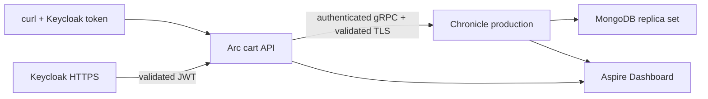

<div align="center">

# Step 08 — Preparing for production

### Run the cart with trusted TLS, real token validation, health probes, and traces

**Arc · Chronicle · JWT · OpenTelemetry**

Previous: [Step 07 — Validation and authorization](../07-ValidationAndAuthorization/README.md) · [Learning path](../README.md)

</div>

---

## What changes

The cart behaves exactly as in step 07, but its host no longer trusts unsigned identity headers. You will run the **production Chronicle image**, validate a customer's JWT, check readiness, and follow checkout through a trace. The copied [specs](./Production.Specs/) still exercise decisions, validation, authorization, projections, and the reactor without infrastructure.



| Development shortcut | This step |
| --- | --- |
| Bundled database and generated server TLS | Separate MongoDB replica set, mounted TLS and encryption certificates |
| Default client credentials, skipped TLS validation | Explicit bootstrapped credentials, `skipTlsValidation=false`, trusted local CA |
| Fabricated forwarded principal | JwtBearer validates Keycloak signature, issuer, audience, and expiry |
| No probes or telemetry backend | Separate liveness/readiness endpoints and OTLP traces/metrics |

Versions: Arc `22.89.0`, Chronicle `19.59.6`; package pins are in [Directory.Packages.props](../../Directory.Packages.props). The server is pinned to `cratis/chronicle:19.59.6`, not a development image.

> [!WARNING]
> **Production-shaped, not ready to deploy unchanged.** All published ports bind to loopback. MongoDB has no authentication/TLS, Keycloak uses its local file database, the dashboard is anonymous, and the cart API uses local HTTP. Keycloak runs **`start` (production mode)** with TLS, not `start-dev`, but its database and demo password grant are learning shortcuts. Use managed/hardened storage, HTTPS ingress, a platform secret store, and production identity/telemetry infrastructure for a real deployment. Authentication still does not enforce cart ownership.

## Start the stack

You need [Docker Compose](https://docs.docker.com/compose/install/), [OpenSSL](https://www.openssl.org/), Bash, `curl`, and [jq](https://jqlang.org/download/). Builds/specs outside Docker also need the [.NET 10 SDK](https://dotnet.microsoft.com/download).

From the repository root:

```bash
cd LearningPath/08-Production
```

Keep **the same terminal** for this exercise. Generate separate random secrets without writing an environment file. Production obtains these values from the platform's secret store instead. Never print them or save expanded `docker compose config` output; container environment inspection can reveal them too.

| Variable | What it protects | Consumer |
| --- | --- | --- |
| `CHRONICLE_CERTIFICATE_PASSWORD` | TLS PFX | Certificate script and Chronicle |
| `ENCRYPTION_CERTIFICATE_PASSWORD` | Encryption PFX | Certificate script and Chronicle |
| `CHRONICLE_CLIENT_SECRET` | `cart-api` client credential | Chronicle bootstrap |
| `CHRONICLE_CLIENT_SECRET_URI` | URI-encoded copy of that credential | API connection string |
| `CHRONICLE_ADMIN_PASSWORD` | Initial `admin` login | Chronicle Workbench |
| `KEYCLOAK_ADMIN_PASSWORD` | Initial `admin` login | Keycloak |
| `DEMO_CUSTOMER_PASSWORD` | Demo `customer` login with `Customer` role | Keycloak realm import and curl |
| `DEMO_VISITOR_PASSWORD` | Demo `visitor` login without that role | Keycloak realm import and curl |

```bash
export CHRONICLE_CERTIFICATE_PASSWORD="$(openssl rand -base64 24)"
export ENCRYPTION_CERTIFICATE_PASSWORD="$(openssl rand -base64 24)"
export CHRONICLE_CLIENT_SECRET="$(openssl rand -base64 24)"
export CHRONICLE_ADMIN_PASSWORD="$(openssl rand -base64 24)"
export KEYCLOAK_ADMIN_PASSWORD="$(openssl rand -base64 24)"
export DEMO_CUSTOMER_PASSWORD="$(openssl rand -base64 24)"
export DEMO_VISITOR_PASSWORD="$(openssl rand -base64 24)"
# Encode the URI-reserved characters in the generated base64 client secret.
export CHRONICLE_CLIENT_SECRET_URI="${CHRONICLE_CLIENT_SECRET//\//%2F}"
export CHRONICLE_CLIENT_SECRET_URI="${CHRONICLE_CLIENT_SECRET_URI//+/%2B}"
bash generate-certificates.sh
docker compose -p l25-prod up -d --build
```

[The script](./generate-certificates.sh) refuses to overwrite existing certificates. Keep the credentials and certificates for as long as you keep the data; bootstrap does not rotate existing passwords on restart. The [Dockerfile](./Dockerfile) installs **only the public CA** into Ubuntu's standard trust store with `update-ca-certificates`. Neither app-to-Chronicle TLS nor JWT metadata retrieval bypasses certificate validation. Rebuild the API if the CA changes. The local leaf certificate covers `chronicle`, `keycloak`, and `localhost`; use separately managed service certificates in production.

Wait for startup (each command fails if its retry budget runs out):

```bash
curl --fail --retry 60 --retry-all-errors --retry-delay 2 http://localhost:18080/health
curl --cacert certs/ca.crt --fail --retry 60 --retry-all-errors --retry-delay 2 \
  https://localhost:8443/realms/cart/.well-known/openid-configuration
curl --fail --retry 60 --retry-all-errors --retry-delay 2 http://localhost:5108/health/ready
curl --fail http://localhost:5108/health/live
```

Chronicle and both API probes should return **200 / Healthy**; Keycloak returns discovery JSON. `/health/ready` selects Chronicle's automatic `ready`-tagged connection check; `/health/live` has no dependency checks. In production, an orchestrator probes the dedicated Chronicle health port externally: its chiseled image contains neither a shell nor curl, so an in-container `HEALTHCHECK` cannot work. The dedicated port here serves **only** `/health`.

> [!NOTE]
> Chronicle 19.59.6 and later fixes the readiness window tracked in [Cratis/Chronicle#4872](https://github.com/Cratis/Chronicle/issues/4872). The `ready` check waits for the client's artifact registration as well as its connection, so an API started before Chronicle was reachable does not report ready while its projections are still registering.

## Authenticate and check out

[Program.cs](./Program.cs) uses `AddCratisArc` plus the ASP.NET Core `WithChronicle` composition, not `AddCratis`'s forwarded-header adapter. JwtBearer keeps claim names unchanged and maps the flat `roles` claim to ASP.NET Core roles. The [realm import](./keycloak/cart-realm.json) supplies that claim and the `cart-api` audience. Internal metadata uses `keycloak:8443`; Keycloak's dynamic backchannel keeps the issuer at `https://localhost:8443/realms/cart` while serving signing keys on the Compose network.

> [!CAUTION]
> The password grant below is **demo-only**. Real frontends use the authorization code flow with PKCE; do not ship `cart-demo` or these imported demo users. Alternatively, use an authenticating ingress such as EasyAuth or Cratis AuthProxy that strips/replaces incoming principal headers and blocks direct backend access. See [Arc identity](https://github.com/Cratis/Arc/blob/main/Documentation/backend/csharp/asp-net-core/microsoft-identity.md) and [bring-your-own authentication](https://github.com/Cratis/Arc/blob/main/Documentation/backend/csharp/chronicle/cratis-package.md#running-arc-or-chronicle-on-their-own).

Obtain both tokens without printing them:

```bash
customer_token=$(curl --cacert certs/ca.crt --fail --silent --show-error \
  https://localhost:8443/realms/cart/protocol/openid-connect/token \
  -d grant_type=password -d client_id=cart-demo -d username=customer \
  --data-urlencode "password=$DEMO_CUSTOMER_PASSWORD" | jq -er .access_token)
visitor_token=$(curl --cacert certs/ca.crt --fail --silent --show-error \
  https://localhost:8443/realms/cart/protocol/openid-connect/token \
  -d grant_type=password -d client_id=cart-demo -d username=visitor \
  --data-urlencode "password=$DEMO_VISITOR_PASSWORD" | jq -er .access_token)
cart_id=$(openssl rand -hex 16 | sed 's/^\(.\{8\}\)\(.\{4\}\)\(.\{4\}\)\(.\{4\}\)\(.\{12\}\)$/\1-\2-\3-\4-\5/')
```

First try checkout anonymously, then as the authenticated visitor:

```bash
curl -i -X POST http://localhost:5108/api/carts/check-out-cart \
  -H 'Content-Type: application/json' -d "{\"cartId\":\"$cart_id\"}"
curl -i -X POST http://localhost:5108/api/carts/check-out-cart \
  -H "Authorization: Bearer $visitor_token" \
  -H 'Content-Type: application/json' -d "{\"cartId\":\"$cart_id\"}"
```

Both return **403** with `isAuthorized: false` and append nothing. Arc reports a command denial, not a sign-in challenge. Any authenticated user may add/query; only a `Customer` may check out:

```bash
curl --fail -X POST http://localhost:5108/api/carts/add-item-to-cart \
  -H "Authorization: Bearer $customer_token" -H 'Content-Type: application/json' \
  -d "{\"cartId\":\"$cart_id\",\"product\":\"Coffee beans\",\"quantity\":2}"
curl --fail -X POST http://localhost:5108/api/carts/check-out-cart \
  -H "Authorization: Bearer $customer_token" -H 'Content-Type: application/json' \
  -d "{\"cartId\":\"$cart_id\"}"
curl --fail -H "Authorization: Bearer $customer_token" \
  "http://localhost:5108/api/carts/by-id?id=$cart_id"
```

The commands return **200** and `isSuccess: true`. The query's `data` eventually has `itemCount: 2`, `checkedOut: true`, and `confirmationSent: true`. The reactor prints a sample confirmation, not real email, and keeps step 04's [at-least-once caveat](../04-Reactors/README.md#replay-and-retries).

Verify that fabricated step-07 headers cannot sign you in:

```bash
principal=$(printf '%s' '{"identityProvider":"fake","userId":"fake","userDetails":"Fake Customer","userRoles":["Customer"],"claims":[]}' | base64 | tr -d '\n')
curl -i -X POST http://localhost:5108/api/carts/check-out-cart \
  -H "x-ms-client-principal: $principal" -H 'x-ms-client-principal-id: fake' \
  -H 'x-ms-client-principal-name: Fake Customer' -H 'Content-Type: application/json' \
  -d "{\"cartId\":\"$cart_id\"}"
```

Expect **403 / `isAuthorized: false`**, even though the forged header claims the customer role.

## Follow the trace

Open the [Aspire Dashboard](http://localhost:18888), choose **Traces**, and select `production-cart`. Open the checkout request: expect `cratis.arc.command.execute`, `cratis.arc.command.handle`, and Chronicle client unit-of-work spans. Both the API and `cart-chronicle` export to the same dashboard. Look at command outcomes/duration under **Metrics**. [Program.cs](./Program.cs) subscribes to Arc's source/meter and `AddCratisChronicleInstrumentation`; the server exports through `OTEL_EXPORTER_OTLP_ENDPOINT`.

Avoid PII in event source ids: Chronicle client spans export them verbatim. Keep tokens, secrets, and event payloads out of telemetry. See [client tracing](https://github.com/Cratis/Chronicle/blob/main/Documentation/hosting/client-tracing.mdx) and [Arc observability](https://github.com/Cratis/Arc/blob/main/Documentation/backend/csharp/observability.md).

## Before a real deployment

- Pin and test server/client versions together; do not leave development credentials or TLS-validation bypasses.
- MongoDB must be a replica set for transactions and change streams. Use authenticated/TLS-protected or managed storage.
- Back up the encryption certificate ring **before** the database and compliance keys. Keep each certificate/password at least as long as the oldest restorable backup.
- Supply the initial administrator password before opening Workbench to traffic; bootstrap does not overwrite existing credentials.
- This is one Chronicle node. Multiple nodes require `Clustering__Type=MongoDB` and shared cluster/service ids; default `Localhost` membership would split the cluster.
- Protect the API, health ports, dashboard, and identity administration with deployment-specific network policy and HTTPS. Keycloak needs a production database and identity lifecycle; replace the demo client/users.

For the complete requirements, read [Chronicle production hosting](https://github.com/Cratis/Chronicle/blob/main/Documentation/hosting/production.md). Multi-node operation, managed database setup, backups/restore drills, tenancy, ownership, and Kubernetes are outside this exercise.

## Reset and prove the behavior

The following destroys **this exercise's** local database volumes and certificates. Do not use it on real data:

```bash
docker compose -p l25-prod down -v
rm -r certs
unset customer_token visitor_token CHRONICLE_CERTIFICATE_PASSWORD ENCRYPTION_CERTIFICATE_PASSWORD \
  CHRONICLE_CLIENT_SECRET CHRONICLE_CLIENT_SECRET_URI CHRONICLE_ADMIN_PASSWORD \
  KEYCLOAK_ADMIN_PASSWORD DEMO_CUSTOMER_PASSWORD DEMO_VISITOR_PASSWORD
```

From the repository root, run the copied specs without Docker:

```bash
dotnet test LearningPath/08-Production/Production.Specs/Production.Specs.csproj --configuration Debug
```

Only [step 06 — Changing events over time](../README.md#coming-later) remains. The [Capstone](../../Capstone/README.md) adds a React screen; this step deliberately stays backend-only.
